<p align="center">
  
</p>

<p align="center">
  <a href="#install"></a>
</p>

<p align="center">
  <a href="https://kolomaster68.github.io/kbflash/"></a>
  
  
  <a href="LICENSE"></a>
</p>

Your MacBook doesn't need a glowing logo to tell you something's done. **kbflash** flashes the
keyboard backlight, then puts it back exactly as it was. Hook it to Claude Code, Codex, a long
build, a script, anything. Step away, glance over, see the keys blink.

## Features

<table>
  <tr>
    <td width="360" align="center" valign="middle">
      
    </td>
    <td valign="middle">
      <b>Your patterns</b><br>
      <code>done</code>, <code>ask</code>, <code>error</code> and <code>breathe</code> to start with. Change them or write
      your own in a plain text file: quick blinks, slow fades, a heartbeat, whatever you'll notice.
      <br><br>
      <b>Anything can trigger it</b><br>
      Claude Code and Codex, any terminal command that runs longer than 30 seconds, or a line at the
      end of your own script. The installer asks which you want.
      <br><br>
      <b>Until you're back</b><br>
      <code>--until-back 30</code> keeps flashing every 30 seconds until you touch the keyboard or
      trackpad, so you can't miss it from across the room.
      <br><br>
      <b>Fits whatever the keyboard is doing</b><br>
      Lit, it dips off and back. Dark, it pulses to full. Timed out, it wakes at your level, flashes,
      then goes back to sleep.
      <br><br>
      <b>Leaves your settings alone</b><br>
      Every flash ends on your level. The slider, brightness keys and auto-brightness work as before.
      <br><br>
      <b>Nothing running in the background</b><br>
      One small command-line tool. Something runs it, it flashes, it exits.
    </td>
  </tr>
</table>

## See it flash

<table>
  <tr>
    <td align="center"><br><b>Lit</b><br><sub>dips off and back</sub></td>
    <td align="center"><br><b>Dark</b><br><sub>pulses to full</sub></td>
  </tr>
  <tr>
    <td align="center" colspan="2"><br><b>Timed out</b><br><sub>wakes, flashes, sleeps again</sub></td>
  </tr>
</table>

<sub>The <code>done</code> pattern, drawn with its real timing (<code>python3 scripts/make-media.py</code> makes them again).</sub>

## Install

You need a MacBook with a backlit keyboard and Apple's command line tools
(`xcode-select --install` if you don't have them).

```sh
git clone https://github.com/Kolomaster68/kbflash.git && ./kbflash/install.sh
```

It builds `kbflash` into `~/.local/bin`, flashes once so you know it works, then asks what should
flash it:

| You choose | What it sets up |
| --- | --- |
| **Claude Code** | `done` when Claude finishes, `ask` when it needs you. Two hooks in `~/.claude/settings.json`; your other hooks are kept. |
| **Codex** | `done` when a turn finishes, via `notify` in `~/.codex/config.toml`. Skipped if you already have a notify program. |
| **Terminal** | `done` or `error` after any zsh command that takes 30 seconds or more. Editors, pagers, `ssh` and agents are skipped. |

Every file it changes is backed up as `*.bak-kbflash`. Say yes to everything with
`./install.sh --yes`.

## Use it with anything

```sh
kbflash                        # done
kbflash ask                    # any pattern by name
kbflash "off/200 on/200 x5"    # or written out
kbflash -- make build          # run something, then done or error by how it went
npm test; kbflash done         # or just after it
kbflash --until-back 30 ask    # keep flashing till you're back at the Mac
kbflash --list                 # your patterns
```

Anything that can run a command can flash your keyboard: other agents' hooks, Shortcuts,
`cron`, `launchd`, Hammerspoon, a git hook. Agents that tack a JSON payload onto the command
(like Codex) are fine; kbflash ignores it.

## Make your own patterns

They live in `~/.config/kbflash/patterns`:

```ini
done      = off/120 on/120 x3
ask       = off/150 on/250 x2
error     = off/120 on/600 off/120 on/150 off/120 on/600
breathe   = ~off/700 ~on/700 x2
heartbeat = off/100 on/100 off/100 on/100 off/700 x2
```

| Write | Means |
| --- | --- |
| `on/150` | Light for 150 ms. "On" is your level if the keyboard is lit, full if it's dark, so it always shows. |
| `off/150` | Dark for 150 ms. |
| `me/150`, `40/150` | Your own level, or an exact percent. |
| `~on/700` | Fade into it over 700 ms instead of switching. |
| `x3` | Repeat the steps since the last `x`. |

Whatever you write, it ends on your level.

For the terminal hook, `KBFLASH_MIN=60` changes the 30 seconds and `KBFLASH_IGNORE` the
programs it skips.

## How it works

<details>
<summary><b>The details</b>: the private interface, the three states, and the trap it avoids</summary>

<br>

Apple has no public API for the keyboard backlight. macOS drives it from `corebrightnessd`, and
apps talk to that through `KeyboardBrightnessClient` in the private CoreBrightness framework,
the same interface the brightness keys and Keyboard settings use.

| Call | What kbflash does with it |
| --- | --- |
| `brightnessForKeyboard:` | Reads your level before flashing, to put it back after. |
| `setBrightness:fadeSpeed:commit:forKeyboard:` | Each step, with `commit:YES`, and a fade time for `~` steps. |
| `isBacklightDimmedOnKeyboard:` | The backlight timed out from inactivity. |
| `isBacklightSuppressedOnKeyboard:` | macOS is holding it off. Set alone, that means a bright room. |
| `suspendIdleDimming:forKeyboard:` | macOS's own keep-awake switch, held for the length of a flash. |

**Three states.** Lit, it flashes from your level. Dark, "on" means full. Timed out, it holds
idle dimming off, which brings the light back at your real level, flashes, then hands idle dimming
back so it times out again as usual. Holding it also stops the light timing out mid-flash.

**The trap.** `commit:NO` looks like the safe choice, a "temporary" brightness that never touches
your setting. It isn't: it's an override that locks out the slider, the brightness keys and
auto-brightness until something commits. kbflash only uses `commit:YES` and always ends on your
level, so as far as macOS knows, you nudged the slider and nudged it back.

**Bright rooms.** With "Adjust keyboard brightness in low light" on, macOS keeps the backlight off
in bright light and ignores writes. kbflash leaves it alone, which is also when a flash would be
hardest to see.

**Until you're back.** `--until-back` reads `HIDIdleTime` from IOKit, the time since the last key
press or touch. Once that's shorter than the time since the first flash, you're back, and it
stops. It gives up after an hour. A flash doesn't count as activity, and it doesn't keep your Mac
or screen awake.

**Screen asleep, lid closed.** macOS switches the keyboard off with the built-in screen and reports
its level as 0. A flash can't show then, and putting "0" back would save it as your level, so
kbflash checks the screen first (`CGDisplayIsAsleep`) and does nothing. As a second guard, if the
keyboard still reads 0 after waking it from idle, it leaves it alone.

**One at a time.** A lock in `/tmp/kbflash.lock` makes a second flash skip while one is running,
so it can't mistake the first one's "off" for your level.

**Interrupted.** Stopped mid-flash (Ctrl-C, `kill`, logging out), it puts your level back first.
Your level is also kept in `/tmp/kbflash.restore` while a flash runs, so if one is force-killed,
the next run puts it back and switches idle dimming on again.

</details>

## Questions

<details>
<summary><b>Which Macs does it work on?</b></summary>
<br>
MacBooks with a backlit keyboard. It's tested on an M5 MacBook Pro with macOS 27. It checks for
each call before using it, so where one is missing it does less rather than failing. External
keyboards aren't supported.
</details>

<details>
<summary><b>What if I've been away a long time?</b></summary>
<br>
Once the keyboard times out, it still flashes: kbflash wakes it, flashes, and lets it time out
again. Once your screen goes to sleep, it can't: macOS keeps the keyboard off with the screen, so
kbflash waits. <code>--until-back</code> carries on checking and flashes again if the screen comes
back on. If your Mac goes to sleep, nothing runs, your agent included.
</details>

<details>
<summary><b>Can it damage the backlight?</b></summary>
<br>
No. The keys are lit by LEDs, and macOS already dims, brightens and switches them off all day,
with the light sensor, the idle timeout and the brightness keys. A few flashes now and then is
nothing next to that, and each lasts a fraction of a second.
</details>

<details>
<summary><b>Will it break with a macOS update?</b></summary>
<br>
It could, because the interface is private. If Apple changes it, kbflash flashes less or not at
all. It won't touch anything else. Open an issue if it stops working.
</details>

<details>
<summary><b>The brightness slider stopped working. What now?</b></summary>
<br>
It shouldn't. If it ever does, <code>./install.sh --uninstall</code> and the slider comes back.
Then open an issue with your Mac model and macOS version.
</details>

<details>
<summary><b>Does it see my prompts, code or commands?</b></summary>
<br>
No. Hooks only run <code>kbflash</code> with a pattern name. The terminal hook looks at how long a
command took and the program's name, to skip editors. Nothing is stored or sent anywhere.
</details>

## Uninstall

```sh
./kbflash/install.sh --uninstall
```

Removes the tool and everything it hooked up. Your patterns file stays.

## Thanks

Inspired by [LogoLight](https://github.com/Ark0N/LogoLight) and
[Backglow](https://backglow.app/macbook-logo-claude-code), which light up the glowing logo on the
new MacBook Pro. kbflash is for every other MacBook.

## License

[MIT](LICENSE). Not made by or affiliated with Apple, Anthropic or OpenAI.
